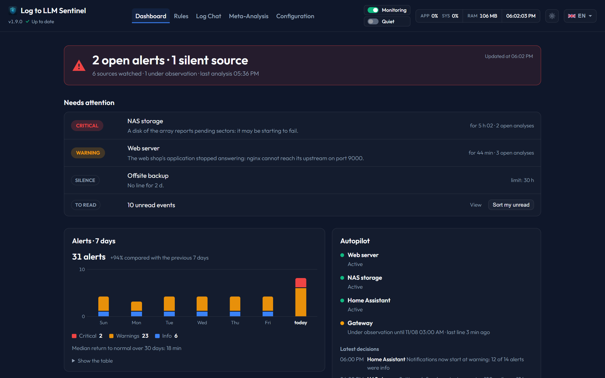
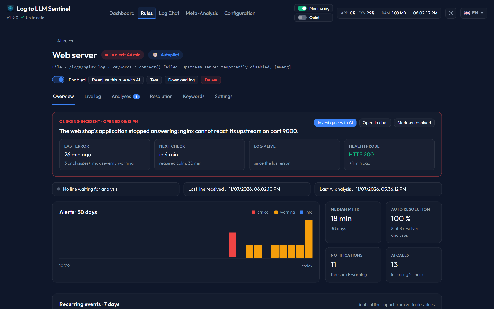
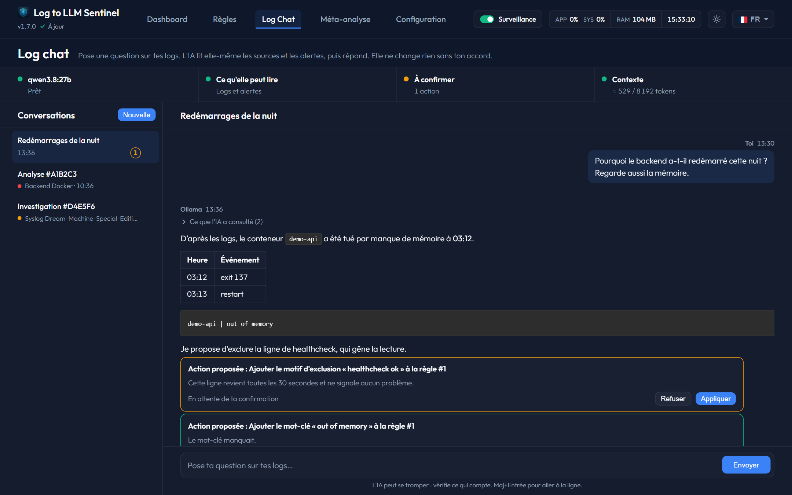
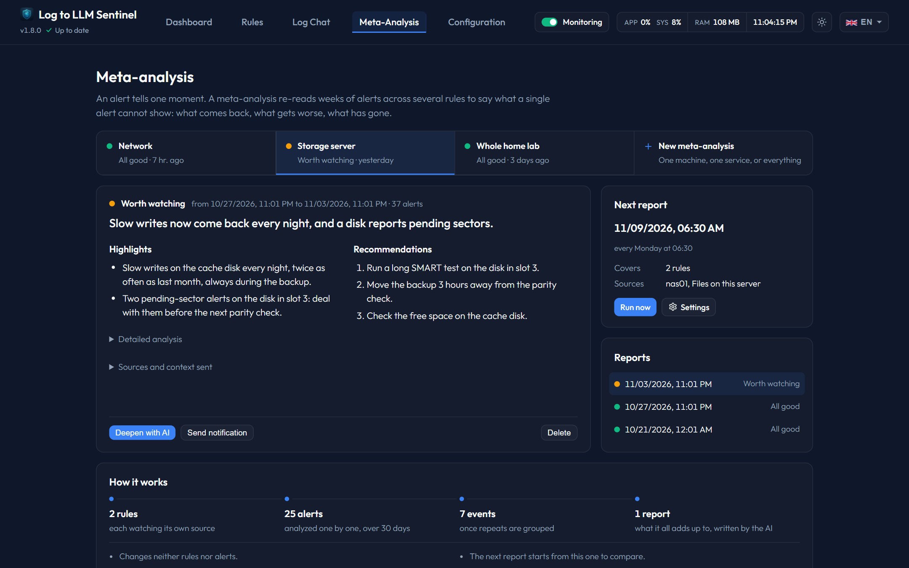
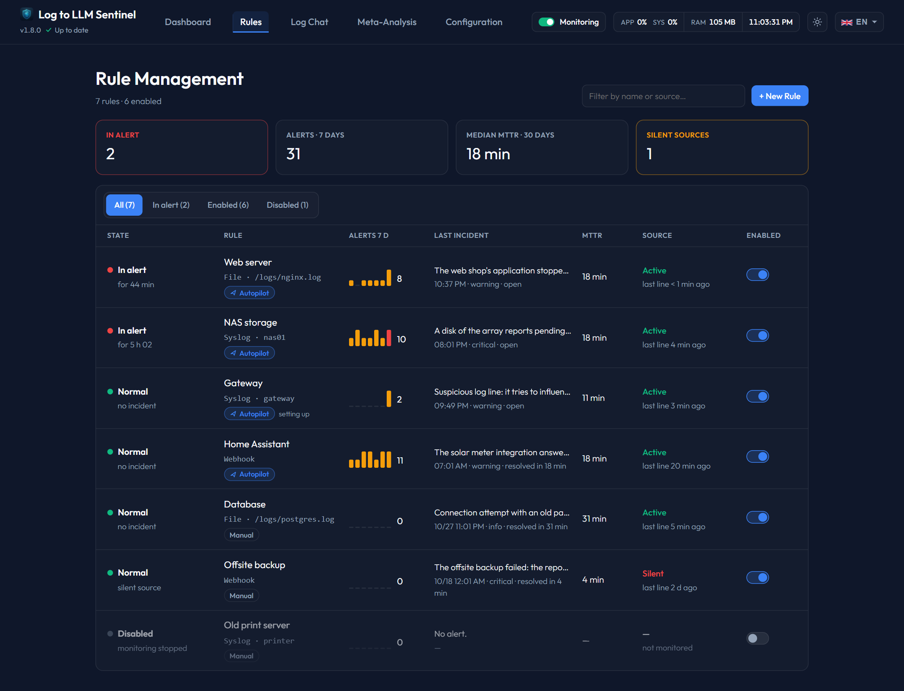
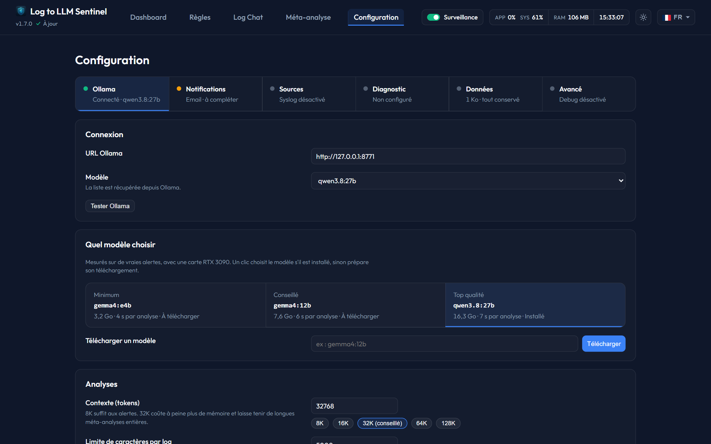

# 🛡️ Log to LLM Sentinel

**Your intelligent log guardian powered by Local AI.**

Log to LLM Sentinel is a modern, lightweight, and powerful log monitoring tool. Unlike traditional tools that just search for text, Sentinel uses **Ollama (Local LLM)** to understand *why* an error happened and tells you exactly what you need to know.

> [!WARNING]
> **Disclaimer**: This application was originally designed to meet the creator's personal self-hosting needs. Security has not been independently audited, as the intended use case is strictly local/private network. Use this software at your own risk. Contributions to improve security, testing, and robustness are highly welcome!


<p align="center">
  
</p>
<p align="center">
  
  
  
  
  
</p>

---

## ✨ Key Features

- 🧠 **Smart AI Analysis**: Don't just get alerted; get an explanation. Sentinel uses Ollama to analyze log context and provide a human-readable diagnosis.
- 💬 **Interactive AI Chat**: Deepen any diagnosis by starting a conversation with the AI. The dedicated chat interface allows you to ask follow-up questions and brainstorm solutions in real-time.
- 🩺 **Read-only Infrastructure Diagnostics**: Instead of telling you to run `docker ps` or `df -h`, the chat AI can check container state, health, restarts and logs, and server disks, memory, network shares and services itself — through a read-only Docker socket proxy and an SSH key restricted to a fixed list of checks. See [Diagnostics](docs/en/features/diagnostics.md).
- 📊 **AI Meta-Analysis**: Get the big picture. Schedule daily, weekly, or monthly reports that aggregate multiple detections into a high-level summary of your system's health and trends.

- 🧭 **Autopilot**: Just give the log source. The local AI reads the history (or watches the source for 24 h), names the rule, describes what is normal in this log, picks the keywords, and sizes the grouping window and the silence alert from the real rhythm of the lines.
- 🤖 **Self-tuning keywords**: Not sure what to look for? Leave the keywords empty: the local AI reads the log history, adds keywords for the errors nothing catches, and removes the noise — every change checked against your data and undoable.
- 📨 **Syslog Server & Relay**: Turn Sentinel into a remote syslog UDP server (listening on port 10514 UDP on host). Ingest remote logs (e.g., from Unraid) and optionally forward them to a secondary syslog server as a relay.
- 📥 **Sort my unread**: Back after a few days? The AI goes through your unread events and suggests which ones can be marked as read, with a reason for each. You validate, and you can undo.
- 🔎 **CVE sheets and web search** (optional): an alert citing a CVE shows whether it is actively exploited and which versions are affected, and the chat can search the web through your own SearXNG, with queries filtered so nothing private leaves.
- 🛡️ **Log line safety**: Log lines can hold text chosen by an attacker. Sentinel treats them as data, and a line that tries to talk the AI out of an alert is flagged instead of obeyed.
- 🔗 **Home Assistant Ready**: Use Webhooks to stream logs from your smart home directly to Sentinel.
- 🔔 **Smart Notifications**: Integrated with SMTP and Apprise (Discord, Telegram, Slack). Sentinel intelligently adapts to character limits by asking the local AI to generate concise summaries when needed, ensuring critical alerts always fit your favorite messaging platform.
- 🌍 **Fully Multilingual**: Beautiful interface available in **English** and **French**.
- 🔒 **100% Private**: Everything runs locally on your machine. No data ever leaves your network.

---

## 🚀 Quick Start (For Non-Experts)

The easiest way to run Sentinel is using **Docker**. This ensures all components (Database, Web Server, and AI) work together perfectly.

### Unraid (Community Applications)
If you are using Unraid, Log-to-LLM Sentinel is available directly from the **Community Applications (CA)** store!
1. Go to the **Apps** tab in your Unraid dashboard.
2. Search for `Log-to-LLM Sentinel`.
3. Click Install and configure your paths.
   - **Note for Custom Logs**: By default, the template maps Unraid's Docker logs (`/var/lib/docker/containers`) and system logs (`/var/log`). If you want to monitor other specific logs (e.g., from a specific appdata folder), add a new Path mapping in the template settings, and then append the container path to the `SENTINEL_BROWSE_ROOTS` variable (e.g., `/logs,/app/data,/docker-logs,/system-logs,/custom-app-logs`).

### Docker & Docker Compose
#### 1. Prerequisites
- Install [Docker Desktop](https://www.docker.com/products/docker-desktop/) (Windows/Mac) or Docker Compose (Linux).
- (Optional) Install [Ollama](https://ollama.com/) locally to use your GPU.

### 2. Get the files
Either **Clone** this repository or **Download** the project as a ZIP and extract it on your computer.

```bash
git clone https://github.com/Aschefr/log-to-llm-sentinel
cd log-to-llm-sentinel
```

### 3. Generate your Configuration
Download the file by right clicking **[docker-setup.html](docker-setup.html)** and select "Save link as")

We provide a visual tool to help you create your `docker-compose.yml` file:

1. **Open it with your favorite web browser** (Chrome, Firefox, Edge...).
2. Select your options (Port, Log folders, AI mode).
3. Copy the generated YAML code.
4. Open the existing **`docker-compose.yml`** file in your project folder, delete its content, and paste your custom code.

### 4. Launch the Sentinel
Open a terminal in your project folder and run:

```bash
docker-compose up -d
```

> **Docker Desktop on Windows: keep the database in a Docker volume.** A folder of your Windows disk, like `./data`, is shared with the container through a slow network layer, and every page then waits for the database: about 1.3 s per request on our test PC, against 50 ms on Linux. Add this to your `docker-compose.yml` to keep `sentinel.db` inside Docker while the rest of `./data` stays on your disk:
>
> ```yaml
> services:
>   sentinel:
>     volumes:
>       - sentinel-db:/app/db
>     environment:
>       - DATABASE_URL=sqlite:////app/db/sentinel.db
> volumes:
>   sentinel-db:
> ```
>
> On an existing install, stop Sentinel and copy `data/sentinel.db` into the volume first, or Sentinel starts with an empty database.

### 5. Access the Interface
Once the containers are started, open your browser and go to the port you chose (default is 10911):
👉 **[http://localhost:10911](http://localhost:10911)**

#### 🤖 AI Configuration Note
- **Internal Ollama**: If you chose the "Internal" mode in the configurator, Sentinel is already pre-configured to talk to its own AI engine.
- **External Ollama**: If you use an existing Ollama install, you will need to enter its address (e.g., `http://192.168.x.x:11434`) in the **Configuration** page of the Sentinel UI.
- **Important**: This project is designed for **Local AI only**. It currently does **not** support external cloud APIs like ChatGPT, Claude, or Gemini.

---

## 📖 How it Works

1. **Define a Rule**: Point Sentinel to a log file or a Webhook token.
2. **Set Keywords**: Choose which words should trigger an alert (e.g., `error`, `failed`, `critical`).
3. **AI Kick-in**: When a match is found, Sentinel grabs the surrounding lines and sends them to your local AI.
4. **Get Notified**: You receive a notification with a summary of the situation and the AI's diagnosis.

### 💡 Self-tuning keywords
Setting up keywords can be tedious, so Sentinel keeps them up to date by itself:
- A new rule analyzes the last 7 days of its log: the AI proposes the keywords that matter.
- Every hour, error lines that no keyword catches ("blind spots") and keywords that only produce noise are reviewed by the local AI.
- Flag an alert **Not relevant** and the AI adds the right exclusion.
- Add a **note** to tell the AI what the logs cannot, such as "this server has no systemd": the next alerts on that event or source take it into account.
- Every change is checked against your data first (it must appear in the real lines, must not hide important alerts…), logged in the rule's **Keywords** tab and can be undone in one click. Prefer to approve each change? Switch the rule to *Suggestions*.

### 📊 Meta-Analysis: The Big Picture
For long-term monitoring, use **Meta-Analysis**:
- Define a schedule (Daily, Weekly, Monthly).
- Select which rules to include.
- Sentinel will collect all relevant analyses and generate a global synthesis.
- Perfect for identifying silent trends that don't trigger individual critical alerts but are recurring.

---

## 🔌 Integrations

### 🏠 Home Assistant Integration

The simplest way is the **Home Assistant** source of a rule: enter the address and a long-lived access token, with nothing to install in Home Assistant. See [Log sources](docs/en/features/sources.md), which also covers Docker logs, MQTT and log shippers.

If you prefer Home Assistant to push its logs, use a webhook:

### 1. Create a Webhook Rule in Sentinel
1. Go to the **Rules** page in Sentinel.
2. Click **+ New Rule**.
3. Keep **Autopilot** to let the AI set up the rule, or choose **Manual**.
4. Under **Source of logs**, select **Webhook API**.
5. Sentinel generates a unique URL for you. Copy this URL, then click **Save**.

### 2. Add the automation to Home Assistant
The best way to integrate this is by using **Packages**, which keeps your configuration clean and modular.

1.  **Install File Editor**: Go to **Settings** -> **Add-ons** and install the **File Editor** add-on (and start it).
2.  **Create the `packages` folder**:
    - Open the **File Editor** UI.
    - Click the **Folder icon** in the top left corner.
    - If you don't see a `packages` folder, click the **New Folder** icon (the folder with a plus sign) and name it `packages`.
3.  **Enable Packages in Home Assistant**:
    - In File Editor, open your `configuration.yaml` file (usually in `/config/`).
    - Add the following lines at the top level (ensure `homeassistant:` is only defined once):
      ```yaml
      homeassistant:
        packages: !include_dir_named packages
      ```
4.  **Create the Sentinel Package**:
    - In File Editor, go into the `packages` folder and create a new file named `log-to-llm-sentinel.yaml`.
    - Paste the following code into it (replace `LOG-TO-LLM-SENTINEL-IP` with the IP address of your Docker host (same as in your `docker-compose.yml`) and `YOUR-TOKEN` with the token from the URL copied from the Sentinel UI (format=xxxxxxxx-xxxx-xxxx-xxxx-xxxxxxxxxxxx)):

```yaml
rest_command:
  sentinel_log_webhook:
    url: "http://LOG-TO-LLM-SENTINEL-IP:10911/api/webhook/logs/YOUR-TOKEN"
    method: POST
    headers:
      Content-Type: "application/json"
    payload: >-
      {{ {"lines": [level ~ " [" ~ name ~ "] " ~ (message | string | truncate(800, True, "...")) ~ (" | EXCEPTION: " ~ (exception | string)[-800:] if exception else "")]} | tojson }}
    timeout: 10

system_log:
  fire_event: true

automation:
  - id: sentinel_forward_ha_logs_realtime
    alias: "Sentinel - Forward HA logs (realtime)"
    description: >
      Envoie chaque entree du journal HA vers Log Sentinel
      en temps reel via system_log_event.
    mode: queued
    max: 100
    trigger:
      - platform: event
        event_type: system_log_event

    condition:
      - condition: template
        value_template: >-
          {{ trigger.event.data.name not in
             ['homeassistant.components.rest_command',
              'homeassistant.util.logging',
              'homeassistant.components.automation.sentinel_forward_ha_logs_realtime',
              'homeassistant.helpers.template'] }}

    action:
      - service: rest_command.sentinel_log_webhook
        data:
          level: "{{ trigger.event.data.level }}"
          name: "{{ trigger.event.data.name }}"
          message: "{{ trigger.event.data.message[0] if trigger.event.data.message is list else trigger.event.data.message | string | truncate(800, True, '...') }}"
          exception: "{{ trigger.event.data.exception | default('') | string }}"
```

4. **Restart Home Assistant** or reload your automations and REST commands.
5. Sentinel will now receive and analyze your smart home logs in real-time!

---

### ☁️ Nextcloud Integration

Find the active `nextcloud.log` in Docker volumes:

```bash
sudo find /var/lib/docker/volumes/ -name "nextcloud.log" -exec ls -lh {} +
```

## 🛠️ Configuration

Sentinel is highly customizable via the **Configuration** page:
- **AI Model**: Pick one of the [recommended models](docs/en/features/recommended-models.md) or any model from Ollama, and the context size.
- **Notifications**: Email (SMTP), Apprise or Discord.
- **Sources**: Syslog receiver and relay.
- **Diagnostics**: Read-only access for the chat AI to your containers and servers.
- **Data**: Retention, backups and restore.

The full guide is in the **[documentation](docs/en/README.md)**.

---

## 💻 Local Development

If you want to run Log to LLM Sentinel locally for development without Docker:

### 1. Prerequisites
- **Python**: Version 3.10 or higher.
- **Ollama**: Installed and running locally (for the AI analysis).

### 2. Setup
1. Clone the repository and navigate to it:
   ```bash
   git clone https://github.com/Aschefr/log-to-llm-sentinel
   cd log-to-llm-sentinel
   ```
2. Create and activate a Python virtual environment:
   ```bash
   python -m venv .venv
   # On Windows (PowerShell)
   .\.venv\Scripts\Activate.ps1
   # On Linux/macOS
   source .venv/bin/activate
   ```
3. Install the dependencies:
   ```bash
   pip install -r requirements.txt
   ```
4. Copy the environment configuration template:
   ```bash
   cp .env.example .env
   ```

### 3. Run the Server
Launch the FastAPI development server:
```bash
uvicorn app.main:app --reload
```
The application will be accessible at: 👉 **http://localhost:8000**

---

## 📄 License

This project is licensed under the MIT License - see the [LICENSE](LICENSE) file for details.

---

## 🤝 Support & Contribution

If you encounter an issue or have a suggestion, feel free to open an issue on the repository. 

**Log to LLM Sentinel** — *Because logs are meant to be understood, not just stored.*
