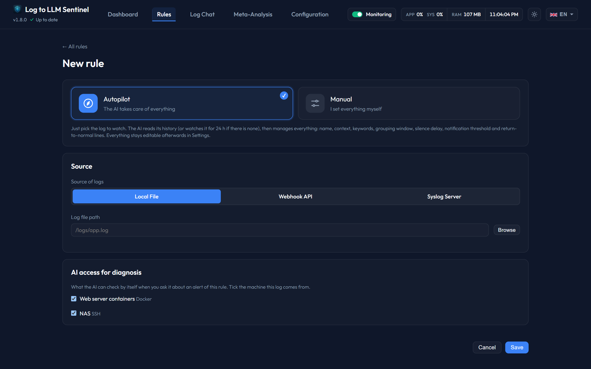

# Autopilot

With the autopilot, you only give a rule its **source** (a log file, a syslog host or a webhook). Sentinel reads the log and the local AI sets up the rest of the rule, then keeps it up to date. The autopilot is on by default for a new rule.

---

## 1. Setting up a rule

When the rule is created, Sentinel reads the last 7 days of the log (current file and rotated files, archives excepted):

* The AI writes the rule's **name** and its **application context**: what this log contains (system, application, services) and what is normal in it. The context then helps the AI judge every alert.
* The [keyword arbiter](keyword-learning.md) chooses the **keywords** and **exclusions**, with the usual checks.
* Two settings come from the real rhythm of the lines, without the AI:
  * the **grouping window**: long enough to gather the lines of one event (twice the usual gap between them, 30 s to 5 min);
  * the **silence delay**: twice the longest silence seen on the source (1 h to 7 days), and at least a day for a source that writes few lines, before warning that the source is silent.

The rule page shows *Autopilot · reading history* in its header, and the setup card in the **Keywords** tab. One notification sums up what was set.

## 2. Without history

A syslog host or a webhook that has not sent anything yet, or a log with less than 50 lines of history (or less than 500 lines over less than 6 hours), is **watched for 24 hours** first (the lines already there count too). The AI then sets up the rule as above. If nothing arrives, the observation starts over, up to 7 days.

While the rule is not set up yet, it alerts on lines that carry an **explicit error level** (syslog priority error or worse, CEF severity 7 or more, JSON `level`, `ERROR`/`FATAL`/`CRIT`…). These alerts show the keyword `[error level]`.

### Sources that only report events

Some sources have no error lines: they tell what happens (UniFi Network, audit logs). You do not need to know which events matter. When a rule has no keyword yet, the arbiter also reviews these events, and keeps what a person in charge would want checked, such as a security threat or a configuration change, not the routine such as clients connecting. Each kept line gets an analysis, and notifications start at `warning`.

If nothing deserves an analysis, the rule says so instead of claiming to be ready: it then only watches for the source going silent, and the autopilot reads the log again every week.

## 3. Afterwards — nothing to approve

The autopilot runs the rule without asking you anything:

* The keyword arbiter keeps reviewing the rule every hour. A change that one of its checks holds back (low confidence, would hide important alerts…) is **dismissed** instead of waiting for your approval: in doubt, the rule stays as it is. It shows in the change history (*Apply anyway* is there if you disagree) and can be proposed again after 30 days, with fresh data.
* **Notification threshold**: from 10 alerts over 30 days, if at least 70 % are `info` (or flagged *Not relevant*), notifications start at `warning`. It is never lowered.
* **Return-to-normal lines** learned by the AI are applied right away, without approval, when they are specific (no generic or failure word, no variable part such as a timestamp), absent from every line that triggered an alert over the last 30 days, present in at most 5 % of the log's lines, and never within 3 lines of an alert line. Learned patterns already active are checked the same way and removed if they fail; patterns you wrote are never touched.
* **Repeated events**: when the last 3 analyses containing the same event were all rated `info` (or flagged *Not relevant*, unless rated `critical`), its lines stop going to the AI, and the rule no longer stays in alert because of them. The event is analyzed again every 6 hours, so a change of verdict brings it back. New events, and events rated higher or whose analysis failed, are always analyzed. The dashboard lists the event once in the autopilot's latest decisions.
* *Review now* in the Keywords tab also runs this upkeep.
* Every week the log is read again: the grouping window and the silence delay are recomputed, and the context is rewritten only if the content of the log changed noticeably (less than half of its most frequent lines are still there).
* **Readjust this rule with AI**, at the top of the rule page, does this re-read right away, on the last 7 days of the log, and also reviews the keywords. The rule keeps alerting meanwhile; progress and result appear in the Keywords tab, where keyword changes can be undone.
* If the setup fails (AI unreachable…), the rule keeps alerting on error-level lines and Sentinel tries again 6 hours later. Cancelling the setup stops these retries; *Analyze history* in the Keywords tab resumes it.

## 4. You keep control

* In **Settings**, a rule on autopilot only shows its source and the autopilot's state. Choose **Manual** to see every setting: the ones set by the autopilot carry an **AI** badge. Saving in Manual stops the autopilot and keeps everything as it is.
* Choose **Autopilot** again and save to switch it back on: it re-reads the log history, keeps the rule's name and a context you wrote, and manages the grouping window, the silence delay, and the context if it is empty.
* The **Rules** list shows at a glance which rules are on autopilot and which are manual.
* Keywords and exclusions are managed in the **Keywords** tab, where every change can be undone.
* A *manual* rule (autopilot off) is set up by hand, as before; the quick templates fill a manual rule.
