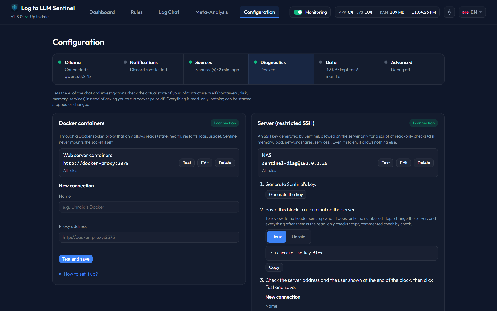

# Infrastructure Diagnostics (read-only)



AI analyses often recommend checks such as `docker ps`, `docker logs`, `df -h` or `systemctl status`. With diagnostics enabled, the assistant of the **Chat** and of **Investigate (🔎)** runs these checks itself and answers from what it actually sees.

Everything is **read-only**: nothing can be started, stopped, restarted or modified. Diagnostics are never used by the automatic alert analysis, only in the chat and investigations. Both parts are optional and independent.

| | Docker diagnostics | Server diagnostics |
|---|---|---|
| What the AI can check | Container list, state, health and last healthchecks, restart count, exit code, OOM, logs, CPU/memory usage | Load, memory, disks, network shares (NFS/SMB), processes, network, kernel messages, system log, systemd services and their journal |
| How | A read-only Docker socket proxy container | An SSH key generated by Sentinel, restricted on the server to one script |
| Setup | One extra container | One block to paste on the server |

---

To let the AI look outside your network, see [Web Search and CVE Sheets](web-search.md).

---

## Several machines, chosen per rule

You can add as many connections as you need, Docker or SSH, each with a name, in *Configuration > Diagnostics*: for example SSH to your Unraid server and the Docker of this machine. Sentinel uses the same SSH key for all of them, so the block of step 2 is the same on every server.

Each rule then says which ones the AI may use, in **AI access for diagnosis** in its Settings tab, also on autopilot, since only you know which machine a log comes from:

* A conversation started from an alert only has access to the connections of its rule. A rule with nothing ticked gets no diagnostic tools.
* A free conversation has access to all of them, and the AI says which one it checked.
* A rule with everything ticked also gets the connections added later.

A previous single configuration becomes two connections named *Docker* and *Serveur*, available to all rules.

---

## 1. Docker diagnostics

Sentinel talks to [docker-socket-proxy](https://github.com/Tecnativa/docker-socket-proxy), which only forwards **read** requests to the Docker socket (`CONTAINERS=1`, `POST=0`). Sentinel itself never mounts the socket.

> ⚠️ Never mount `/var/run/docker.sock` directly into Sentinel, even with `:ro`: the read-only flag does not restrict the Docker API and the socket is equivalent to root access on the host.

### Docker compose (Linux, NAS, VPS)
Add this service to the same `docker-compose.yml` as Sentinel (the [configurator](../../../docker-setup.html) adds it for you):

```yaml
  docker-proxy:
    image: tecnativa/docker-socket-proxy:v0.5.0
    container_name: sentinel-docker-proxy
    environment:
      CONTAINERS: 1
      POST: 0
    volumes:
      - /var/run/docker.sock:/var/run/docker.sock:ro
    # No "ports:" section: only Sentinel can reach it, through the compose network.
    restart: unless-stopped
```

Run `docker compose up -d`, then in Sentinel: **Configuration › Diagnostics › Docker containers**, the address `http://docker-proxy:2375` is already filled in: click **Test and save**.

### Unraid
Unraid has no compose and containers on its default bridge cannot reach each other by name, so both containers go on a dedicated network:

1. In the Unraid terminal, once: `docker network create sentinel`. To see it in the *Network type* list, *Settings › Docker › Preserve user defined networks* must be set to **Yes** (the Docker service has to be stopped to change it).
2. **Apps** tab → install **dockersocket** (IBRACORP) → *Network type*: `sentinel`. Keep `CONTAINERS=1` and `POST=0`, and do not add a port mapping.
3. Edit the **Log-to-LLM-Sentinel** container → *Network type*: `sentinel`.
4. Sentinel → **Configuration › Diagnostics**: choose the Unraid tab under *How to install it?* so the address `http://dockersocket:2375` is filled in, then click **Test and save**.

> Do not publish the proxy port on your LAN: even read-only, it exposes the configuration of every container (including environment variables). Sentinel strips environment variables and labels before passing container details to the AI.

---

## 2. Server diagnostics (restricted SSH)

Sentinel generates an SSH key. On the server, this key is only allowed to run one script (`command=` and `restrict` options in `authorized_keys`). Sentinel only sends the **name** of a check (`disk`, `memory`, `service nginx`…); the script maps each name to a fixed command and rejects anything else. Even a stolen key cannot open a shell, forward ports or run another command.

### Step 1 — generate the key (in Sentinel)
**Configuration › Diagnostics › Server** → **Generate the key**. The private key stays in Sentinel's data folder (`data/ssh/`); only the public key is displayed.

### Step 2 — install on the server (CLI)
Choose your platform, click **Copy** and paste the block in a terminal on the server.

To review it before pasting: the header sums up what the block does, only the numbered steps change the server, and everything after them is the read-only checks script, with a comment above each check.

**Linux (Debian, Ubuntu…)** — the block, run with `sudo`:
- creates a system user `sentinel-diag` (member of `systemd-journal` and `adm` to read journals),
- installs the script at `/usr/local/bin/sentinel-diag`,
- authorizes the key in `/home/sentinel-diag/.ssh/authorized_keys` with `restrict,command="/usr/local/bin/sentinel-diag"`.

**Unraid (6.9 or later)** — paste it in the Unraid terminal (root). Unraid runs from RAM and its USB flash drive cannot hold executable files, so the block:
- stores the script on the flash drive (`/boot/config/sentinel/sentinel-diag.sh`) and runs it through `bash`,
- authorizes the key for `root` in `/boot/config/ssh/root/authorized_keys` (kept across reboots) and in the current session, with `restrict,command="bash /boot/config/sentinel/sentinel-diag.sh"`.
- SSH must be enabled: *Settings › Management Access › Use SSH*.

The block can be pasted again safely (it replaces its previous key line).

### Step 3 — fill in Sentinel
- **Server address**: the server's LAN IP (as reachable from the Sentinel container); pre-filled with the server IP from the general settings when set.
- **Port**: `22` unless you changed it.
- **User**: shown at the end of the block — `sentinel-diag` on Linux, `root` on Unraid (pre-filled for the selected platform).

Click **Test and save**: the values typed in the form are tested and saved only if the connection works (a **Save anyway** button appears otherwise). The output of the `overview` check is shown with the server's key fingerprint, which Sentinel remembers (connections fail if it changes).

### Available checks
`overview`, `disk`, `memory`, `load`, `processes`, `mounts`, `network`, `kernel`, `syslog`, `array`, `failed-services`, `service <name>`, `journal <name>`.

- `array`: on Unraid, the array state (started, sync errors, resync, disabled/invalid disks) and each disk's status, error count, temperature and file system; elsewhere, software RAID (`/proc/mdstat`) and ZFS pools (`zpool status -x`).
- `kernel` and `network` leave out Docker's network noise (veth, bridges); `syslog` leaves out Sentinel's own SSH sessions.
- Unraid has no systemd: `service`, `journal` and `failed-services` point to `syslog`, `array` and `processes` instead.

### Updating the script
The script carries a version number. When a new Sentinel version improves it, **Test and save** warns that the installed script is outdated: paste the step 2 block again (the key does not change).

### Revoking access
Once the key exists, **Configuration › Diagnostics › Server › Remove access** shows the block that undoes the installation for the platform chosen in step 2:
- Linux: removes the key from `/home/sentinel-diag/.ssh/authorized_keys`, deletes `/usr/local/bin/sentinel-diag`, then the `sentinel-diag` user and its home folder.
- Unraid: removes the line containing `sentinel-diag` from `/boot/config/ssh/root/authorized_keys` (and from `/root/.ssh/authorized_keys` when it is a separate file), then deletes `/boot/config/sentinel/sentinel-diag.sh` and its folder.

Then click **Forget the server in Sentinel** to clear the address and user (server diagnostics are disabled and the tools are no longer offered to the AI).

You can also **Regenerate** the key in Sentinel: the previous key stops working everywhere, since Sentinel no longer holds it.

---

## 3. In the chat
When at least one part is configured, the assistant receives the corresponding tools (`docker_list_containers`, `docker_container_status`, `docker_container_logs`, `docker_container_stats`, `host_check`) and is told to use them instead of asking you to run commands. Each call appears in the collapsible **Tools used** list of the answer. Outputs are bounded (200 log lines, 4,000 characters) like the other tools.
