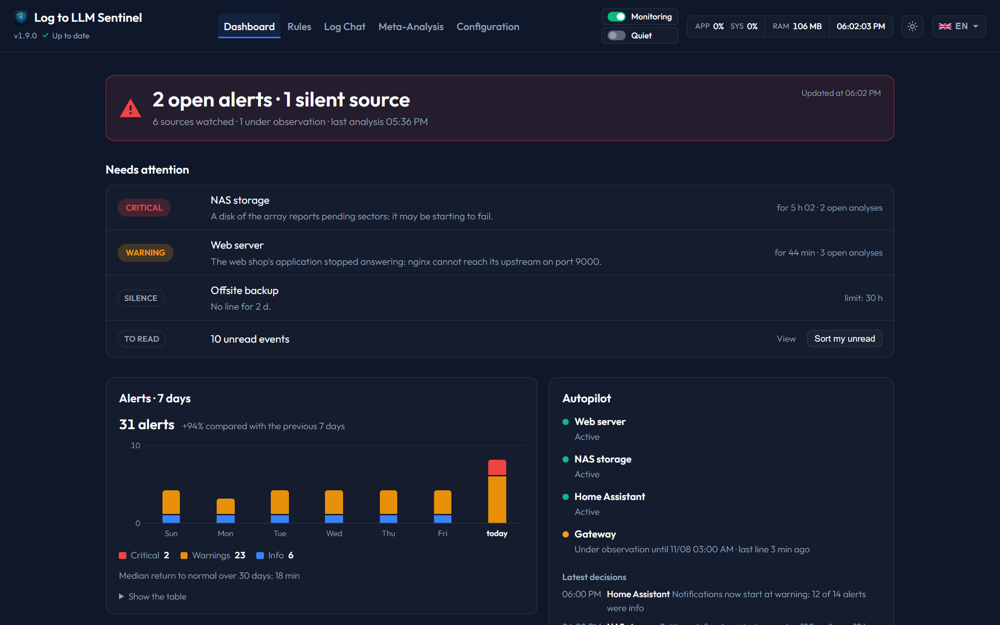

# Inactivity Monitoring

A log that stops is a problem too: a crashed application, a stuck service, a stopped container or a sender that lost its connection. **Inactivity Monitoring** warns you when a source has written nothing for too long.

---

## 1. How It Works
* **Background check**: every 5 minutes, Sentinel compares the current time with the last line received by each enabled rule.
* **Notification**: past the rule's limit, one notification goes out through your [configured method](../pages/configuration.md). It says when the last line arrived. Nothing else is sent until lines come back and the source goes silent again.
* **No AI involved**: this check makes no call to the model.

A silent source also appears in **Needs attention** on the [Dashboard](../pages/dashboard.md), where it changes the verdict, and as *Silent* in the [Rules](../pages/rules.md) list.

---

## 2. Setting the Limit
In the **Notifications** section of a rule's Settings tab, tick **Send an alert if inactive** and enter the number of hours allowed without a line.

With the [autopilot](autopilot.md), you have nothing to set: the limit comes from the real rhythm of the source, twice the longest silence seen, and is recomputed every week. The notification is always on in this mode.

---

## 3. When It Does Not Alert
* While a rule is under autopilot observation, because its rhythm is not known yet. Its silence is shown in the Autopilot block of the Dashboard.
* While [monitoring is paused](monitoring-pause.md). A source still silent is reported at the next check after resuming.
* On a disabled rule.
