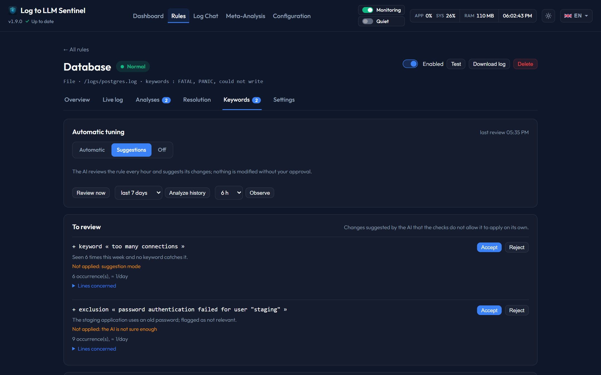

# Keyword tuning

Sentinel keeps each rule's keywords and exclusions up to date by itself. The local AI acts as an **arbiter**: it reads what actually happens in the log, decides what to change, and every decision is checked against your data before it is applied. Every change is logged and can be undone in one click.

---

## 1. What Sentinel watches, continuously

For every line a rule receives, Sentinel counts (no AI involved, very light):

* **Hits per keyword and per exclusion**, per day (kept 30 days).
* **Blind spots**: error lines that no keyword catches — an explicit error level (syslog priority ≤ 3, JSON `level`, `ERROR`/`FATAL`/`CRIT`…) or a failure word (*failed*, *refused*, *unable*, *out of memory*…). Similar lines are grouped into one template (numbers, addresses, identifiers and timestamps are masked).

## 2. The hourly review

Every hour, for each enabled rule whose tuning is not *Off*, the arbiter receives:

* **Blind spots** seen at least 3 times → *add a keyword*, or *ignore* (expected, transient, maintenance, a container being stopped…). One keyword per event, even when it writes several lines.
* **Noisy keywords** → *keep*, *add an exclusion* for the useless lines, or *remove the keyword*. A keyword is reviewed when ≥ 10 alerts over 30 days are ≥ 90 % `info` without any `critical`, or when you flag one of its alerts **Not relevant**.

Flagging an alert **Not relevant** (button on every alert card) flags every occurrence of that event and triggers this review right away for that rule: the arbiter targets the flagged lines with a precise exclusion rather than dropping a keyword that also catches useful alerts. The next analyses of that event are told about the flag too.

The arbiter also receives the rule's [notes](notes.md). Its safeguards still apply.

## 3. Checks before anything changes

| Proposal | Discarded when… | Offered to you instead of applied when… |
|---|---|---|
| Add a keyword | it is not literally in the error lines, is generic (`error`, `failed`, a lone exception name such as `CancelledError`, `Traceback (most recent call last)`…), contains a variable part (number, IPv4 or IPv6 address…), an exclusion would neutralize it, or it matches a line of an alert flagged *Not relevant* over the last 30 days | the AI's confidence is below 70, or it would match more than 200 lines a day |
| Add an exclusion | it is not literally in the noisy lines, or is generic | it would hide a `warning`/`critical` alert of the last 30 days, or neutralize a keyword, or confidence < 70 |
| Remove a keyword | — | it is the rule's last keyword, it triggered `critical` alerts or many `warning`s, or confidence < 70 |

A change you **reject** or **undo** is never proposed again. Editing the keywords by hand wins as well: if you remove a keyword the arbiter added, it is marked undone.

## 4. Modes (per rule)

* **Automatic** (default): checked decisions are applied; the others wait in **To review**.
* **Suggestions**: every decision waits for your approval.
* **Off**: keywords only change when you edit them.

When anything is applied or proposed, one notification sums it up (if the rule's notifications are on).

## 5. The Keywords tab

On each rule page, **Keywords** shows:

* the mode and the time of the last review, **Review now**;
* **Analyze history** (last 1 to 30 days) and **Observe** (next 1 to 24 hours) — see below;
* **To review**: pending changes, with the reason, why they were not applied and the lines involved — **Accept** / **Reject**;
* the **keywords**: alerts over 30 days and their severities, lines matched per day, last alert, origin (by hand, blind spot, noise, feedback, learning, chat), and a warning when an exclusion neutralizes a keyword;
* the **exclusions**: lines ignored per day, origin;
* the **blind spots being watched**;
* the **change history**, with **Undo** on applied changes.

## 6. Learning on a period

**Analyze history** reads the whole period in a single pass — the current file and the rotated `.1` file — and groups every line into templates. Lines without a timestamp (stack traces) belong to the previous line; timestamps without a time zone are aligned on UTC using the file's modification time. **Observe** waits for the period to end, then analyzes what arrived.

The arbiter then receives the blind spots and, for each keyword, the templates it catches, and decides with the same checks as the hourly review. Templates whose lines are always written together (within 2 seconds, both ways) are one event: the arbiter sees them as one blind spot with its companion lines and takes the keyword from the clearest one. It sees up to 16 blind spots, the most frequent ones, with 4 places kept for one-off incidents (all their lines within 6 hours). It answers at temperature 0 with a fixed seed, and an unreadable answer is asked again once. The session card shows what was read and changed, offers **Undo these changes** and **Download the AI log** (a text file with the data sent to the AI and its decision).

A new rule runs this analysis on the last 7 days when it is created (option in the rule form), so the keyword field can be left empty.

## 7. Keyword matching

Keywords and exclusions match case-insensitively, as substrings. A keyword that is a number or 3 characters or fewer must match a **whole word**: `502` matches `HTTP/1.1" 502` but not a port `:50231` or an interface `vethb68c502`; `oom` matches `oom-killer` but not `zoom`.
