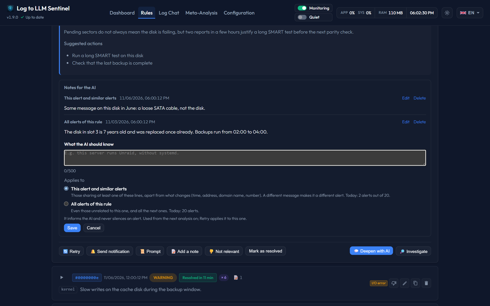

# Notes for the AI

The AI only knows what the logs say. A note tells it what they cannot: the operating system of a server, a part you just replaced, a known cause. Sentinel sends your notes with the next alerts, so the diagnosis and the proposed actions fit your system.

## Adding a note

Open an event on the dashboard or in a rule's **Analyses** tab, then choose **Add a note** (500 characters at most, 30 notes per rule). A note applies to one of two scopes:

* **This alert and similar alerts**: alerts with the same error lines, and alerts that share at least one of them (shown as *Similar alert*). Lines are compared apart from what changes, such as the time, an address, a public domain name or a number. A different message makes it a different alert.
* **All alerts of this rule**: every alert of the rule, even unrelated ones, and all the next ones.

The form says how many alerts each choice concerns today.

The link between a note and an alert is computed from the lines, not guessed by the AI. Two alerts with no line in common are not linked, and a note never crosses from one rule to another. For knowledge that concerns everything the rule watches, use a note on all its alerts.

A rule's **Analyses** tab lists all its notes in a folded banner above the alerts. Folded, it already says how many notes apply to the whole rule and how many to specific alerts. Open, it shows them in two groups: **Whole rule**, where you can add a note on all alerts of the rule, and **Specific alerts**, each with the line it was written on (add those from the alert itself). You can edit or delete any note there.

## What the AI receives

| Where | Notes sent |
|---|---|
| Alert analysis, including **Retry** | The 5 closest to the alert: same alert, then similar alerts, then those on all alerts of the rule, newest first. If the context is too small, the last ones are left out. |
| **Deepen with AI** and **Investigate** | The same selection, kept after the conversation is compressed. |
| Chat tool that reads an analysis | The same selection. |
| Keyword arbiter | The 8 most useful notes of the rule, with the line each one is about. |
| Autopilot description of the log | Notes on all alerts of the rule. |
| Meta-analysis | For each rule, the 5 closest to the events of the period. |

The **Prompt** button of an analysis shows exactly what was sent. A new note is used from the next analysis on; **Retry** applies it to an existing one.

Automatic resolution checks do not receive notes.

## A note informs, it does not silence

A note never blocks an alert or a notification and never caps a severity. The AI is told that a note does not prove the current event has the same cause, and that it must say so if the lines contradict a note or show something more serious. Each note is sent with its date, so an old note reads as an old note.

To stop an alert from firing, use **Not relevant**, which adjusts the keywords: see [Keyword tuning](keyword-learning.md). On an autopilot rule, it can also pause the analysis of that event for up to 6 hours, except for an event rated `critical`: see [Autopilot](autopilot.md).

## How long a note lasts

Notes follow the rule. They stay when analyses are deleted or purged, and apply again if the event comes back. Deleting the rule deletes its notes. They are part of every backup, with or without history.
