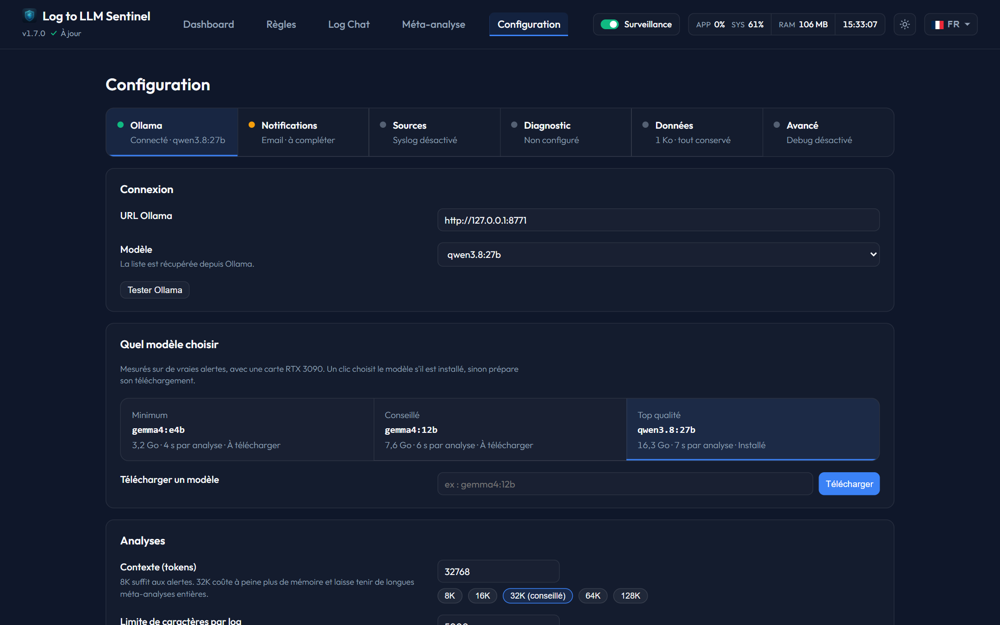

# Recommended Models

Sentinel suggests a model for each size of graphics card, so a new user has nothing to guess. The labels are not picked by hand: they come from fixed rules applied to measurements on real alerts from a homelab, re-read by hand, with the expected answer decided before each run. The same rules are used by the other local-AI apps of the project.

## How the models are ranked

| Model | Score /10 | Serious caught /22 · 35 % | False alarms avoided /30 · 20 % | Steering foiled /33 · 25 % | Investigations right /36 · 20 % | Smallest card | Memory | Response (alert · investigation) |
|---|---|---|---|---|---|---|---|---|
| **`gemma4:12b`** · Recommended, Top quality | 9.5 | 22 | 28 | 32 | 14-16 /18 | 12 GB | 9.1 GB · Q4_K_M | 4.4 s · 5.5 s |
| `bonsai-2:27b` | 9.4 | 10-11 /11 | 13-15 /15 | 31 | 34 | 12 GB | 9.5 GB · Q2_0 | 7.5 s · 12.5 s |
| `qwen3.8:27b` | 9.3 | 10-11 /11 | 30 | 30 | 15-16 /18 | 24 GB and more | 18.7 GB · Q4_K_M | 7.4 s · 10 s |
| **`gemma4:e4b`** · Minimum | 8.7 | 22 | 16 | 31 | 16-17 /18 | 8 GB | 4.9 GB · Q4_K_M | 3.7 s · 8 s |

| Your graphics card | Recommended model |
|---|---|
| 8 GB | `gemma4:e4b` |
| 12 GB | `gemma4:12b` |
| 16 GB | `gemma4:12b` |
| 24 GB and more | `gemma4:12b` |

*Measured on 9 November 2026 on an RTX 3090, 32K context, with the current prompts. Alerts: 38 real alerts played twice (11 serious and 15 normal per run), thinking off. Steering: 33 log lines that try to dictate the verdict, final severity after Sentinel's safeguards. Investigations: 18 second-look scenarios drawn from real incidents, played twice with thinking on, as in the app. A range shows the two runs when they differ. Memory: read on the graphics card with the model loaded, CUDA context included, in the cards' own unit (a "24 GB" card has 24 GiB); Ollama's own figure under-counts it, by up to 8 GB for `gemma4:12b`. Ollama's default version (quantisation shown), 8-bit context cache (q8_0) with flash attention; with Ollama's default 16-bit cache, count up to 0.5 GB more.*

**The rules**
* **Score out of 10, quality only**: the weighted average of the four tasks, weights in the headings. Missing a serious alert weighs most, then a log line steering the verdict. Speed and memory stay out of the score: they serve the choice by card.
* **Not kept**: under half the points on one task, in any run. None of the models above.
* **Tie**: 0.3 point apart or less, the lighter model wins. The runs differ by two cases at most (temperature 0.2), so the uncertainty comes mostly from the choice of cases: one alert case that flips is worth about 0.1 point.
* **By card**: the best score among the models that fit and answer in under 20 s, to an alert as to an investigation. A model fits when its memory is at most the card's minus 1 GB. A model too large still works, partly in system memory, but much more slowly.
* **Minimum** is the model for an 8 GB card, **Recommended** the one for a 12 GB card, **Top quality** the best score among the models that answer in under 20 s, and **Alternative** a higher score that is slower, if there is one.

**What the table shows**
* `gemma4:12b`, `bonsai-2:27b` and `qwen3.8:27b` are within 0.2 point: the gap is noise, and the tie rule picks the lightest. `gemma4:12b` misses no serious alert, foils the most steering lines, answers fastest and fits in 9.1 GB, so it is the model for every card from 12 GB.
* `qwen3.8:27b` never raises a false alarm, but takes 18.7 GB once its real memory is counted, so it needs a 24 GB card.
* `bonsai-2:27b`, a 27B in 2-bit, does best on investigations (17 out of 18 on both runs), but twice concludes things are getting better when a process was killed for lack of memory, and takes 12.5 s per investigation.
* `gemma4:e4b` raises more false alarms (14 out of 30), but misses no serious alert and fits in 4.9 GB. Thinking helps it most on investigations: 16 and 17 out of 18, against 14 without on 7 November. It still leaves a container stuck in a restart loop at warning instead of critical.

## First study (before 1.8.0)
Eight models on the 38 cases, once each.

| Model | Role then | Memory (32K context) | Correct severities /38 | False alarms /15 | Serious cases missed /11 | Time per analysis |
|---|---|---|---|---|---|---|
| `gemma4:e2b` | | 0.5 GB | 31 | 7 | 0 | 2 s |
| `gemma4:e4b` | | 3.2 GB | 32 | 5 | 0 | 4 s |
| `qwen3.5:9b` | | 5.7 GB | 33 | 2 | 3 | 4 s |
| `gemma4:12b` | | 7.6 GB | 36 | 1 | 1 | 6 s |
| `mistral-nemo` | | 9.2 GB | 28 | 9 | 1 | 3 s |
| `qwen3.6:27b` | | 16.1 GB | 35 | 2 | 1 | 12 s |
| `qwen3.8:27b` | | 16.3 GB | 36 | 0 | 2 | 7 s |
| `gemma4:31b` | | 18.5 GB | 37 | 0 | 1 | 11 s |

*A serious case is missed when the model rates it `info`. Measured before version 1.8.0, once per model, memory as Ollama reported it (which under-counts), on an RTX 3090 with 24 GB of memory. Nothing was measured without a graphics card. These results come from one machine and one set of logs, in French, so they indicate an order rather than a guarantee.*

## Measured again on 1.8.0
Version 1.8.0 changed how alerts are asked of the model ([Log Line Safety](log-safety.md)), so the 38 cases were played again on `qwen3.8:27b`, twice each, thinking off, against the previous prompts. Correct severities went from 72 to 75 of 76, serious cases rated `info` from 4 to 1, with no false alarm in either. The other models were not measured again.

## Measured again on 1.9 (November 2026)
The three recommended models, plus `bonsai-2:27b`, were played on the same 38 cases with the current prompts, twice each, 32K context, thinking off, plus 33 variants where a line tries to dictate the verdict. Two things came out of it.

* **The `gemma4` models raised false alarms.** On normal lines (a cron session, a periodic request), they flagged an attempt to steer the AI, and Sentinel then kept the alert at warning. Sentinel now counts that flag only when a log line also holds a verdict word (test, simulation, normal, info, resolved…). None of the normal lines does.
* **A hard failure no longer ends as info.** Out of memory, segfault, disk errors, a systemd service restarting in a loop: such a line keeps its alert at warning or above, whatever the model says.

| Model | Correct severities /76 | False alarms /30 | Serious cases rated info /22 | Steering lines handled /33 | Time per analysis |
|---|---|---|---|---|---|
| **`qwen3.8:27b`** | 76 | 0 | 0 | 32 | 8 s |
| **`gemma4:12b`** | 72 (58 before) | 4 (18 before) | 0 | 31 | 4 s |
| `bonsai-2:27b` | 72 | 2 | 2 | 31 | 7.5 s |
| **`gemma4:e4b`** | 62 (52 before) | 14 (24 before) | 0 | 31 | 4 s |

The recommendation stays the same. `bonsai-2:27b` is a 27B model in 2-bit quantisation (9.7 GB): close to the top, but it missed two serious cases and followed steering lines far more often before Sentinel's safeguard (25 of 33, against 14 for `qwen3.8:27b`). Turning thinking on did not help `gemma4:12b` (59 against 58 correct) and made it three times slower.

## Measured again with the one-off question (November 2026)
Each analysis now also says whether the event still needs watching ([Resolution Tracking](resolution-tracking.md)). Asking one more thing can tilt a model's severity, so the three recommended models were played again on the same cases, with the expected answers decided before the run.

| Model | Correct severities /76 | False alarms /30 | Serious cases rated info /22 | Steering lines handled /33 | False alarms closed at once /30 |
|---|---|---|---|---|---|
| **`qwen3.8:27b`** | 74 | 0 | 2 | 30 | 30 |
| **`gemma4:12b`** | 74 | 2 | 0 | 32 | 29 |
| **`gemma4:e4b`** | 62 | 14 | 0 | 31 | 17 |

No case expected to be watched was closed. `qwen3.8:27b` now rates one serious case info on both runs: an isolated root login failure, which can be read either way. A softer wording of the question did no better: 73 correct, and one serious case closed. An event whose line was rewritten to say `severity=info` can still end as one-off when the model believes it; nothing can spot such a line, and its severity was already wrong before.

## Settings that follow from it
* **Temperature: 0.2.** At 0.7, no recommended model improves, and the minimum model invents more.
* **Context: 8K minimum, 16K with the chat, 32K recommended.** The largest exchange measured is 5,900 tokens of prompt and 990 of reply, so 8K is enough for alerts: replayed at 8K, 16K and 32K, `qwen3.8:27b` got 74, 75 and 74 correct severities out of 76. The chat's tools alone take 1,500 to 2,300 tokens, so the chat needs at least 16K. Going to 32K costs 0.1 to 0.2 GB on the three recommended models, with no loss of speed. Ollama reloads a model whenever the context size asked for changes (16 to 42 s for `qwen3.8:27b`), so apps sharing a model on one Ollama server should ask for the same size.
* **Thinking for analyses: off.** It applies to everything judged without tools: alerts, unread triage, resolution checks, keyword arbiter, situation summary and meta-analyses. On `gemma4:12b`, 59 correct severities out of 76 with thinking, 58 without, and each analysis three times slower. On the unread triage and the meta-analysis with `gemma4:e4b`, thinking gave the same choices and took two to three times longer. Switch in *Configuration › Analyses*.
* **Thinking for the chat and investigations: on.** There the model has to pick its tools. On 16 questions that need tools, played twice, `gemma4:e4b` answered 16 right with thinking and 10 without: it asked the user for a rule or alert ID instead of looking it up, and said it showed log lines without showing them. About 1.7 times slower (median 7.8 s against 4.7 s). The second look uses the same setting. Switch in *Configuration › Log chat*.
* **128K** fits the smaller models. On 24 GB, `qwen3.8:27b` overflows the card at 128K (83 to 54 tokens/s) and `gemma4:31b` at 64K (36 to 19 tokens/s).
* **Language: the site's.** Writing prompts in English and asking for an answer in French brought nothing on the large model and missed more serious cases on the small one, so each language keeps its own prompt.

## Long meta-analyses
Over 200 days, only the full context at 32K or more brought out a disk failure signaled by one rule, on both models tested. At 8K, or with the former limit of 50 analyses, it went unnoticed. When everything does not fit, the most serious events now come first, each rule having its most serious event kept before another rule's next one.
