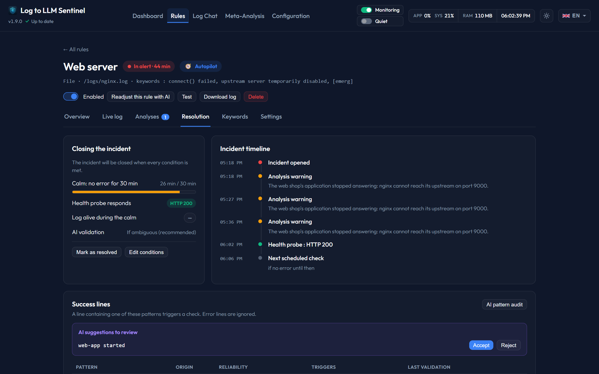

# Incident Resolution

Sentinel tracks when an alert returns to normal, which feeds the MTTR and closes incidents without manual work. Everything is configured in the **Return to normal** section of a rule's Settings tab and observed in its **Resolution** tab.

---

## 1. How an incident closes
An incident opens with the first analysed alert of a rule and stays open until **all** these conditions are met:

* **Calm**: no new error for the required duration.
  * *Adaptive* (default): three times the median interval between the incident's errors, never below the rule's minimum and capped at 24 h. An error that comes back every 2 h therefore waits more than 6 h before the incident is closed, instead of flapping open/closed.
  * *Fixed*: always the configured duration.
* **Health probe** (optional): an HTTP(S) request (expected status codes, 2xx/3xx by default) or a TCP connection (`host:port`) defined by you. It runs every 60 s during an incident. As long as it fails, the incident stays open, even if the log is silent — which catches a service that crashed and stopped writing. Certificates are not verified (self-signed certificates are common on a LAN). Use **Test the probe** before saving.

**One-off events open no incident.** When the analysis says an event is already over in its lines (a blocked attack, a Wi-Fi client that left, an isolated failure, a finished task), the alert is closed as soon as it is analysed, with the status *One-off*: the rule does not go into alert, there is no calm to wait for, and it does not count in the MTTR. Its notification is unchanged. The analysis cannot do this for a critical alert, for a line that reports a hard failure (out of memory, segfault, disk errors, a service restarting in a loop), or when a line tries to dictate the verdict: those are always watched. When in doubt, the AI is told to keep watching.

**One-off signals are traces, not alerts.** An alert whose lines all report a connection already blocked by the security device (CEF `act=blocked`, `dropped`, `denied`…), or that only keywords marked *One-off signal* caught, is a signal: an *info* card closed at once (*One-off*), with no notification, no second look and no return to normal to wait for. A repeat reuses the previous verdict without calling the AI. A hard failure, a batch that also holds a line caught by an ordinary keyword, or a line that tries to dictate the verdict is never a signal. Mark a keyword in the rule's Keywords tab (*One-off signal* / *Make it an alert*). The autopilot marks the keywords it adds for chronic errors, more than one an hour, every day, for at least 3 days (see [Keyword learning](keyword-learning.md)).

A **success line** can close the incident earlier: when a line contains one of the rule's success patterns (and is not itself an error line), Sentinel checks whether the problem is over.

---

## 2. AI validation
* **If ambiguous** (recommended): the AI only checks success lines. A full calm (with a passing probe if configured) closes the incident without any LLM call.
* **Always**: the AI also confirms closures after a full calm. Slower and uses the GPU more.
* **Never**: no LLM call; the first success line or a full calm closes the incident.

The AI receives the incident (start, duration, time since the last error, summaries of its open analyses), the trigger, the number of normal lines received since the last error, the probe result and the last 30 lines of the source, and answers with a structured verdict (resolved, confidence, explanation). Below 50 % confidence (30 % for a pattern with a weight of 3 or more) the verdict counts as a rejection.

### Safeguards
* One check per rule at a time; a check is abandoned if a new error arrives meanwhile.
* After a rejection, the next calm check waits a full calm period and a success line is not considered again for 5 minutes.
* Error lines (trigger keyword, not excluded) never count as success lines.
* Check history is kept for 30 days (the 20 most recent per rule are always kept).

---

## 3. Resolution tab
* **Closing the incident**: calm progress, probe state, log liveness and AI mode, with *Mark as resolved* and *Edit conditions*.
* **Timeline**: incident opening, analyses, checks and their verdicts, probe result, next scheduled check.
* **Success lines**: each pattern with its origin (manual or learned), reliability (weight), accepted/rejected triggers and last validation. Add a pattern manually or delete one; **AI pattern audit** asks the AI to remove irrelevant patterns.
* **AI suggestions to review**: after a resolution triggered by a success line (or a manual one), the AI may suggest new patterns from the normal log lines. They are only used once you **Accept** them; **Reject** prevents them from being suggested again. Generic phrases (`exiting`, `Starting`, `message repeated`…), phrases found in the incident's error lines or overlapping an error keyword are never suggested. Unreviewed suggestions expire after 14 days.
* **Check history · 30 days**: date, trigger, verdict (*Accepted by AI*, *Closed without AI*, *Rejected by AI*, *Rejected (low confidence)*, *Manual*, *False positive*), AI confidence and explanation. **False positive** on a closing verdict decrements the patterns involved and, if the rule is still normal, reopens the incident with the analyses that closure had resolved.

## 4. Pattern weights
A pattern's weight grows by 1 each time it triggers a resolution validated by the AI, and decreases when a resolution is marked as a false positive or when the pattern has not been validated for 14 days (it is removed at 0).
