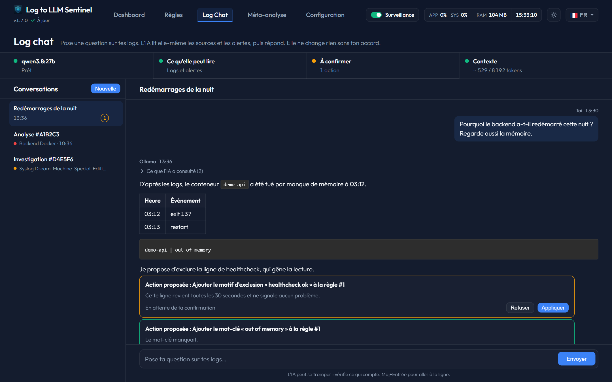

# AI Analysis Center (Log Chat)

The **AI Analysis Center** provides an interactive chat interface to troubleshoot and diagnose complex logs with the local LLM.

---

## 1. Chat Interface
* **Conversations Sidebar**: Lists all current active diagnostics.
  * *New Button (+ New)*: Creates a blank conversation.
  * *Delete Button (🗑️)*: Permanently deletes the selected conversation.
* **Message History**: Displays user queries, Ollama responses, and attached contexts.
* **Query Input Field**: Enter questions, code fragments, or log snippets. Press **Send** to query the model.
  * *Ollama is thinking...*: Visual loading indicator that appears while waiting for model stream responses.

---

## 2. Dynamic Context & Compression Settings
Ollama contexts are limited by token sizes. To prevent crashes or memory loss, Sentinel includes automated saturation management:
* **Settings Gear (⚙️)**: Located in the chat header, this opens the context tuning panel:
  * **System Prompt**: Customize system instructions for the LLM during chat sessions.
  * **Query Language**: Set the default language for responses.
  * **Management Mode**:
    * *Always ask*: Prompts the user to select a compression method once the token limit is reached.
    * *Truncate*: Discards oldest messages to fit the limit instantly.
    * *Compact*: Minimizes space usage (whitespace removal) preserving all data.
    * *AI Summary*: Uses a lightweight LLM task to summarize the history, saving up to 70% of context tokens.
* **Attached Analysis Context**: Clicking this accordion shows the exact log line and previous analysis injected into the chat memory.

---

## 3. AI Tools & Guided Investigation
When the selected Ollama model supports tool calling (Sentinel checks the model's capabilities automatically), the assistant can look up information by itself instead of guessing:
* **Read-only tools**: list rules and their alert state, read the latest lines of a rule's source, get the lines around an analysis or a timestamp, search a source for a text, list or open past analyses, get rule statistics (alerts per day, MTTR, most frequent events), read the resolution history, and find **correlated events across all rules** around a given time.
* **Tools used**: Each answer shows a collapsible "Tools used" list with one chip per call (e.g. *Search "NFS" #3*), updated live while the model works.
* **Safety limits**: At most 4 tool rounds and 8 calls per answer (6 and 12 for an investigation), bounded output per tool (100 lines / 4,000 characters), tool results capped at 40% of the context size, duplicate calls skipped. Tools only accept rule or analysis IDs, never file paths.
* **Proposed actions**: The assistant cannot change anything by itself. It can propose an action (add an exclusion pattern, add or remove a keyword, mark a rule as resolved, exclude an analysis from MTTR, resend a notification, run a meta-analysis), shown as a card with **Apply** and **Decline** buttons. Nothing happens until you click **Apply**.
* **Investigate (🔎)**: Available on analysis cards (Dashboard, rule page) and in the attached analysis context. It opens a new conversation where the assistant follows an investigation plan (wider context, recurrence, correlated events, resolution history) and writes a structured report: findings, ranked hypotheses, checks to run and a recommendation.

> Tool rounds make answers slower: each round is a new generation. With a large local model, an investigation can take several minutes.
