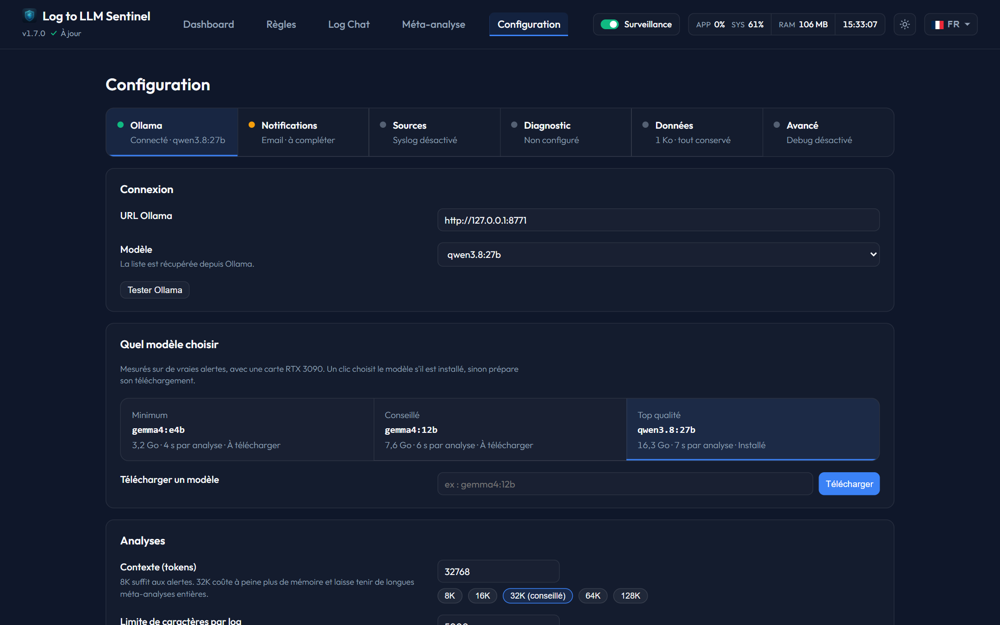

# Global Configuration

The **Configuration** page handles global integration credentials, LLM parameters, maintenance settings, and system backup/restoration.

## Tabs and their state
The six tabs at the top of the page each show the real state of what they configure, in text and with a colored dot.

| Tab | What it can say |
|---|---|
| **Ollama** | Connected with its model, model missing, unreachable, or not set up |
| **Notifications** | Incomplete, not tested, or the result and time of the latest test or real send. Changing the settings of the method brings it back to *not tested*: an older success no longer proves anything. |
| **Sources** | Syslog off, not listening, on with nothing received in 7 days, or the number of sources and the latest line |
| **Diagnostics** | Which of Docker and the server are set up. This is checked by **Test and save** in that tab, not every time the page opens. |
| **Data** | Size of the data folder and how long data is kept |
| **Advanced** | Whether debug mode is on |

If the state cannot be read, the page says it is unknown.

## Saving
A setting is saved when you leave its field (or press Enter), and the result shows next to the field. A failure stays visible until the next attempt. **Test** buttons use what you just typed. A saved SMTP password is never sent back to the page: leave the field empty to keep it.

---

## 1. Notifications tab
* **Instance Name**: Prefixed in notification subjects, to tell several Sentinel instances apart.
* **Primary Notification Method**: Dropdown selector to choose between `Email (SMTP)`, `Apprise`, or `Discord Webhook`.
* **SMTP Settings**:
  * *SMTP Host / Port*: Address of your email provider (e.g., `smtp.gmail.com`).
  * *Encryption Mode*: Choose `TLS / STARTTLS` (Port 587), `SSL / TLS` (Port 465), or none.
  * *Credentials*: Username and Password fields.
  * *Recipient*: Address where alert emails are sent.
  * *Test SMTP Button*: Sends a test email to verify credentials.
* **Apprise Settings**:
  * *Apprise URL*: The target URL of your Apprise agent endpoint.
  * *Apprise Tags*: Comma-separated tags to route alerts.
  * *Character Limit (AI Summary)*: Sets the character threshold before compressing text for mobile-friendly alerts.
  * *Test Apprise Button*: Sends a test notification.
* **Discord Settings**:
  * *Discord Webhook URL*: Paste your Discord channel integration webhook.
  * *Test Discord Button*: Sends a test message.

---

## 2. Ollama tab
* **Ollama URL**: The access endpoint of your Ollama instance (default: `http://host.docker.internal:11434` for Docker hosts).
* **Model Selection**: Dropdown list populated dynamically by queries to Ollama.
* **Model (Manual Override)**: Text field to specify a model manually (e.g., `llama3:latest`).
* **Which model to choose**: three [recommended models](../features/recommended-models.md), with their memory and speed as measured. One click selects a model if it is installed, otherwise prepares its download.
* **Download a model**: enter any model tag and click **Download** to pull it onto the host.
* **Context**: 8K to 128K, 32K recommended. Meta-analyses and the chat use the same value, which also avoids reloading the model.

The temperature is set to 0.2 and analyses are written in the site's language: the study behind these recommendations settled both, so there is nothing to adjust.

---

## 3. Sources tab
**Detected sources** lists the hosts that sent lines in the last 7 days and the rule following each one.

Sentinel listens on UDP port 514 inside the container (mapped to host port 10514 by default):
* **Enable Syslog Receiver**: Master checkbox to activate the UDP listener.
* **Forwarding Address (Relay)**: Enter an IP:Port to forward raw incoming Syslog packets to another destination (e.g., a secondary NAS or SIEM server).
* **Copy Helpers**: Displays the host's LAN IP address and ports to quickly configure remote syslog clients (e.g., Unraid, routers, switches).

### Sending UniFi logs to Sentinel
UniFi has **two separate syslog settings**, and the first one alone does not send network events (seen on a UDM SE with UniFi Network 10.6):

| Setting | Where | What it sends |
|---|---|---|
| **Activity Logging (Syslog)** | Settings > CyberSecure > Traffic Logging | UniFi Network events (WiFi clients, threats, internet failover) and device logs |
| **System Logging / SIEM** | Integrations (Control Plane) | UniFi OS events only (admin logins, configuration changes). Its *Send Test Event* works even when no network event is sent. |

To receive network events, in **Activity Logging (Syslog)** choose **SIEM Server**, enter Sentinel's address and syslog port (10514 by default), then select the contents:
* **Keep**: Clients, Security Detections, Critical, Triggers, and the others you need. Access Points and Switches send few lines.
* **Leave out at first**: **Firewall Default Policy** and **Gateway**. With them, one network sent about 800 lines per minute, mostly firewall lines and DNS queries, which also reveal what your devices visit.
* **Leave unchecked**: Debug Logs and Netconsole. UniFi warns that debug logs greatly increase the volume and may contain sensitive information.

The console uses **two host names**: `Dream Machine Special Edition` for UniFi OS events and `Dream-Machine-Special-Edition` for network events (from the console's name). Create the rule on the name with hyphens: the rule form lists the detected hosts.

---

## 4. Data tab
**Maintenance** also holds two resets, each with a confirmation: **Reset the MTTR** removes already resolved incidents from the calculation and keeps the analyses; **Delete all analyses** permanently deletes every analysis of every rule.

* **Auto-Delete Old Data**: Toggle switch to purge old logs.
* **Retention Period**: Purge frequency (`1 week`, `1 month`, `6 months`, `1 year`).
* **Clean Up Now Button**: Triggers an immediate database cleanup.
* **Export Configuration**:
  * *Include history*: Checkbox to export historical logs and chat databases.
  * *Generate Zip Button*: Generates and downloads a ZIP backup of rules, configs, and history.
* **Import Configuration**:
  * *Select Backup File*: Choose a previously exported ZIP file.
  * *Restore Backup Button*: Restores all rules, settings, and histories, overwriting current database entries.

---

## 5. Advanced tab
* **Live log lines**: Number of lines shown in a rule's *Live log* tab.
* **Log file**: Sentinel's messages are kept across restarts in `data/logs/sentinel.log`, rotated at 5 MB with 3 older files. **Download the log** gives them all as a ZIP. They are also visible with `docker logs`, and they are not part of the configuration export.
* **Debug mode**: Adds the detail of each step and the full prompts and answers of Ollama calls to the log file. Prompts copy lines of your logs, so turn it off once the problem is found.

The **Diagnostics** tab is described in [Infrastructure Diagnostics](../features/diagnostics.md).

---

## 6. Docker Setup Configurator
To customize or regenerate your initial docker deployment parameters, use the built-in interactive **[Docker Configurator](../../../docker-setup.html)**. It generates custom `docker-compose.yml` templates pre-configured with the host Systemd journal bridge, custom log folder mounts, and local NVIDIA CUDA GPU accelerated Ollama setup instructions.

