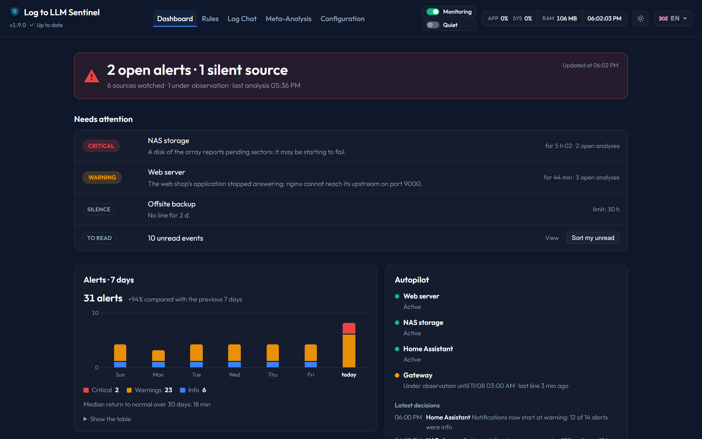
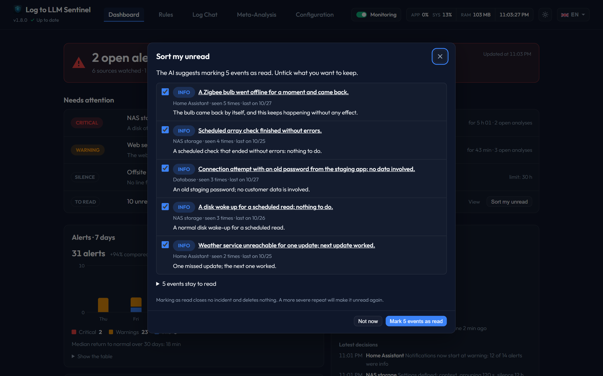

# Dashboard Page

The **Dashboard** is the home screen of Log-to-LLM Sentinel. It is a watch post: it first answers "is everything fine?", then shows only what needs an action.

The page updates by itself every 15 seconds, and right away when you come back to its tab. An update never closes or moves what you are reading.

---

## 1. Verdict
The heading of the page, also shown in the browser tab:
* **All good**: nothing needs attention.
* **The list of problems** (e.g. *1 open alert · 1 silent source*): red when a critical alert is open, orange for anything else (an alert rated below critical, a silent source, an autopilot failure, an Ollama problem).
* **Unknown state**: Sentinel stopped responding. The page never shows *All good* on old data, and offers **Retry**.
* **No source is being watched** or **Monitoring is off**: there is no rule yet, or every rule is disabled.

Below it: the number of sources watched and under observation, and the time of the last analysis.

---

## 2. Situation
A few sentences on the state of your monitoring, under the verdict.
* **The AI's paragraph** connects the facts: what needs your attention, which events on several rules come from one cause, what is repetitive noise already resolved. A marker such as **#1544** opens the analysis it refers to. Below it: when it was written.
* **The facts** come straight from the database, without AI, so they are always current: the rules watched, those in alert or silent, the events of the last 24 hours (how many are new, how many still open), and the longest silence of a source still under its limit.

The paragraph is rewritten in full, never added to, and only when the situation changes: an alert opens or closes, a source goes silent, a new event appears. It waits for any alert being analysed, so it never delays one. The AI reads only these facts and the summaries already written by the analyses, never a log line, and a summary from an analysis that saw an attempt to steer the AI is left out. If the AI is unavailable or monitoring is paused, the facts stay shown. The paragraph can be turned off in *Configuration › Analyses* (*Situation summary written by the AI*).

---

## 3. Needs attention
Only what calls for an action, most serious first:
* **Open alerts**, with the AI's summary and how long they have been open. A row opens the alert on its rule page.
* **Autopilot failures**: the autopilot will try again on its own.
* **Ollama problems**: server unreachable, model not installed or no server configured.
* **Silent sources**: no line for longer than the rule's limit. A rule under autopilot observation is not listed: its rhythm is not known yet, so its silence is shown in the Autopilot block instead.
* **Unread events**: **View** opens the *Unread* filter of the history. They do not change the verdict.
* **Sort my unread**: the AI goes through your unread events and suggests which ones can be marked as read, with a reason for each. You untick what you want to keep, then validate. Nothing changes before that, and the last sort can be undone for 7 days. Critical events are never suggested. Events first seen less than a day ago, or seen only once in the last 7 days, reach the AI marked as recent: it suggests one only if a note calls it normal, it was flagged as not relevant, or its summary says it resolved on its own. An event seen only once, 7 days ago or more, that never came back can be suggested. Marking as read closes no incident and deletes nothing. Reopened within ten minutes, the window shows the same result without asking the AI again; **Check again** runs it on the unread events of the moment. The same button is on the *Analyses* tab of a rule, limited to that rule.

---

## 4. Alerts over 7 days
One bar per day, split by severity, with the total, the comparison with the previous 7 days and the median return to normal over 30 days (the same MTTR as the Rules page). Hover or focus a bar for its values, or open **Show the table**. Days follow the server's UTC calendar.

---

## 5. Autopilot
The rules on autopilot with their state (reading the history, under observation until a given time, active, failed), then the latest decisions: settings defined, return-to-normal patterns applied or removed, keywords and exclusions changed or dismissed. A rule opens its page, where each decision can be reviewed.

---

## 6. Ollama
The configured model and whether the server responds, with the analysis running and those waiting.

---

## 7. History
Analyses grouped by **event**: analyses of a rule with the same error lines (or the same lines when none looks like an error), apart from variable parts such as dates, durations, addresses and identifiers. A new error line always makes a new event. Newest first, filtered by severity or unread.

* A row reads in three lines: the event's highest severity, the rule and the time; the latest summary (bold while unread); then, in small text, how it ended (*Resolved in…* or *Open*), the number of occurrences, the notes, the component that wrote the lines and the detection ID. The quick actions (mark as read, not relevant, note, copy, delete) show when you point at the row or reach it with the keyboard; on a phone they stay under it. The keywords are inside the row. It opens the full explanation, the triggering lines, the actions (retry, notify, deepen in the chat, add a [note for the AI](../features/notes.md), flag as not relevant, delete) and the list of the other occurrences. **Not relevant** applies to the whole event, and stays on when the event repeats at the same severity.
* The unread count is a count of events. Opening one marks all its occurrences as read. It becomes unread again only if a new occurrence is more serious than what you have read.
* Nothing is deleted by grouping: statistics, the 7-day chart and the keyword tuning still count every analysis. Deleting a row deletes all the occurrences of that event.

The **Analyses** tab of a rule works the same way.

---

## Moved to Configuration
*Reset the MTTR* and *Delete all analyses* are now in **Configuration > Maintenance**, each with a confirmation.

The server statistics (CPU, RAM, uptime) stay in the navigation bar.
