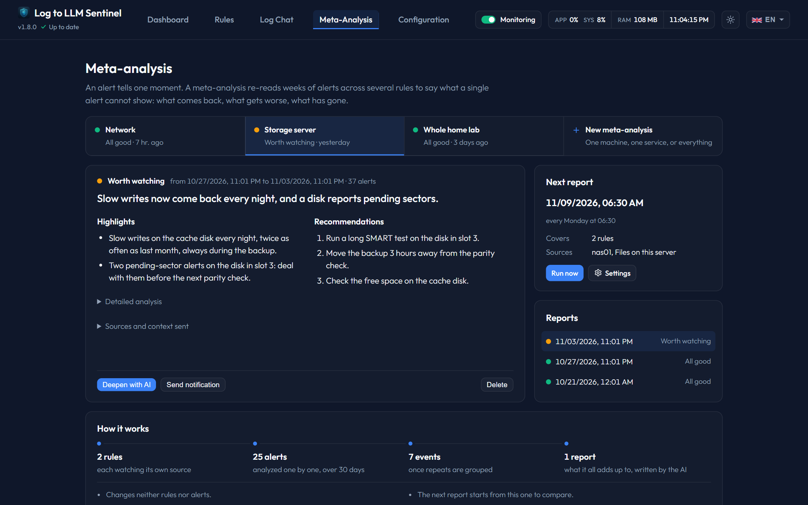

# Meta-Analysis Page

**Meta-Analysis** allows users to schedule periodic syntheses of log data across multiple rules, creating a consolidated overview of service health.

---

## 1. Active Configurations List
* **New Configuration (+ New)**: Opens the setup modal.
* **Configurations Feed**: Displays all active periodic analyses:
  * *Frequency Label*: Displays daily, weekly, or monthly schedules.
  * *Target Rules Count*: Lists the number of rules monitored.
  * *Last Run*: Shows the timestamp of the last executed analysis.
  * *Reset Period Button (↺)*: Resets the schedule tracking to the default start date.
  * *Edit / Delete Buttons*: Modify or delete the configurations.

---

## 2. Setting Up a Meta-Analysis Configuration
* **Configuration Name**: Display label for the scheduled job.
* **Target Rules**: List of checkboxes. Select specific rules, or leave empty to include all rules.
* **Frequency Dropdown**:
  * *Every day*: Set target local hour.
  * *Every week*: Select weekday (Monday-Sunday) and local hour.
  * *Every month*: Select day of the month (1-31) and local hour.
* **Context Size (tokens)**: Token size to allocate to Ollama (`2048`, `4096`, `8192`, `16384`, `32768`).
* **Max Included Analyses**: Max count of historical logs included in the context.
* **System Prompt override**: Custom prompt instructions for the summary task.

---

## 3. Interactive Preview & Custom Runs
Expanding the **Preview of pending data** accordion allows users to:
* **Covered Period Inputs**: Adjust the Start/End dates to target a custom analysis window.
* **Exclusion Buttons (× Exclude)**: Interactively exclude specific logs from the scheduled summary block.
* **User Annotation Fields**: Add custom text notes to any log entry before launching.
* **Run Button (▶ Run)**: Executes the summary task immediately using the filtered/annotated context.
  * *Stop Button*: Aborts a running task.
* **Deepen with AI**: Redirects to the Analysis Center, pre-loading the meta-analysis result as the initial conversation context.

---

## 4. How the Synthesis Is Built
* **Aggregated context**: Instead of pasting every analysis, Sentinel groups identical events (same message once timestamps, IPs, ports and IDs are ignored) and sends one line per group: occurrence count, first/last occurrence, hours of occurrence, severity, unresolved count, a sample line and the latest analysis summary. Each rule gets its totals, resolution rate, MTTR and current alert state, and rules without alerts are listed.
* **Max Included Analyses** still caps how many of the most recent analyses are detailed; the total number of alerts over the whole period is always reported so the model knows what was left out.
* **Trend vs. previous run**: The TL;DR of the previous synthesis is included, so the model can flag what is new, persistent or gone.
* **Structured result**: Each synthesis has an overall status (🟢 OK / 🟠 Degraded / 🔴 Critical), a short TL;DR, key points, the detailed synthesis and recommendations.
* **Notifications**: Discord/Apprise notifications use the status, TL;DR and key points directly when the full synthesis is too long, without a second LLM call.
* **Preview exclusions & annotations** are applied server-side to the aggregated context.
