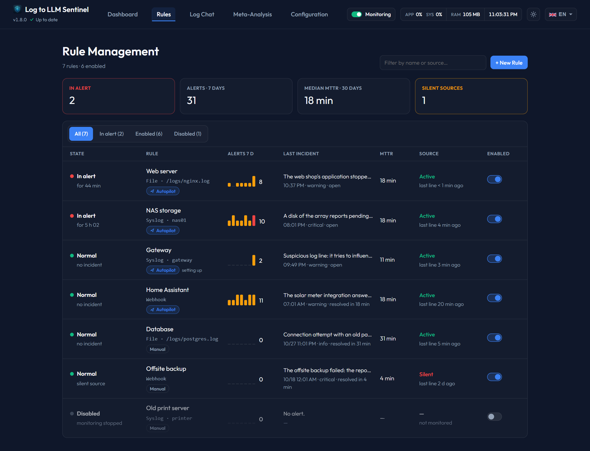

# Rules

The **Rules** entry is where you watch and configure everything Sentinel monitors. It replaces the former *Rules* and *Monitor* pages: an overview lists every rule, and each rule has its own page with tabs.

---

## 1. Overview (`/rules`)
* **Indicators**: rules in alert, alerts over 7 days, median MTTR over 30 days, silent sources.
* **Filters**: All / In alert / Enabled / Disabled, plus a search field (name or source).
* **One row per rule**, disabled rules included:
  * *State*: Normal, In alert (since when), or Disabled. A disabled rule that still has an open incident is shown as *incident still open*.
  * *Alerts 7 d*: one bar per day, coloured by the highest severity of the day.
  * *Last incident*: its one-sentence summary, time, severity and whether it is open or how long it took to resolve.
  * *MTTR*: median resolution time over 30 days.
  * *Source*: Active or Silent (no line received for longer than the rule's silence threshold).
  * *Enabled*: toggle to disable or re-enable the rule directly from the list.
* Click a row to open the rule page. **+ New rule** opens an empty rule page on its Settings tab.

---

## 2. Rule page (`/rules/{id}`)
The header shows the name, state, source and keywords, an **Enabled** toggle and the **Test**, **Download log** and **Delete** buttons.

### Overview tab
* **Ongoing incident** (when the rule is in alert): summary of the latest analysis, last error, next resolution check and required calm, number of normal lines received since the last error (is the log still alive?), and the health probe result. Buttons: *Investigate with AI*, *Open in chat*, *Mark as resolved*.
* **Activity**: lines waiting in the grouping window, last line received, last AI analysis.
* **Alerts · 30 days** chart and indicators: median MTTR, auto-resolution rate, notifications sent, AI calls.
* **Recurring events · 7 days**: identical lines apart from variable values (timestamps, IDs, IPs…), with count, last occurrence, usual hours and typical resolution time. *Ignore these lines…* opens the Keywords tab with the most specific part of the line in the exclusion field; nothing is saved until you click Add.
* **Latest analyses**: click one to open it in the Analyses tab.

### Live log tab
The former Monitor viewer: live tail with keyword highlighting, *Matches* / *All* / per-keyword / per-exclusion filters, freeze and copy, and a detail panel when clicking a line (related analysis, or *Analyse with AI* for an unmatched line).

### Analyses tab
* Filters with real counters: All, Unread, Critical, Warning, Info; period (7 days, 30 days, all); *Open incidents only*; *Mark all as read*.
* Each collapsed card shows the one-sentence summary, a recurrence badge (*× N in 7 d* or *new*) and the resolution time.
* Expanded cards keep the usual actions: retry, notify, prompt, deepen in chat, investigate, delete — plus **Not relevant**, which asks the AI arbiter to stop this kind of alert (see [Keyword tuning](../features/keyword-learning.md)).

### Resolution tab
See [Incident Resolution](../features/resolution-tracking.md): closing conditions of the ongoing incident, timeline, success-line patterns and AI suggestions to review, check history.

### Keywords tab
See [Keyword tuning](../features/keyword-learning.md): tuning mode, history analysis and observation, changes to review, keywords and exclusions with their real hits and alerts, blind spots being watched, change history with undo.

### Settings tab
Five sections:
1. **Source**: name, local file (with file browser and preview), webhook URL or syslog hostname.
2. **Detection**: trigger keywords, ignored lines (exclusions), the [automatic tuning](../features/keyword-learning.md) mode (and, for a new rule, *analyze the last 7 days* on creation) and the **grouping window** — lines detected during this window are analysed together in a single AI call.
3. **AI analysis**: application context (what this rule monitors and what is normal here) and the number of **context lines** read from the source before and after the detected lines.
4. **Notifications**: notify alerts from a minimum severity, notify when an incident closes, alert when the source goes silent for N hours.
5. **Return to normal**: see [Incident Resolution](../features/resolution-tracking.md).

---

## 3. Old links
`/monitor` links (notifications, chat, meta-analysis) still work: `/monitor?search=<detection id>` opens the analysis in its rule page, `/monitor?rule=<id>&line=…` opens the live log on that line.
